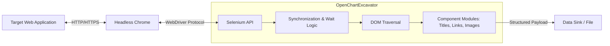

# OpenChartExcavator

Automates the extraction and structuring of dynamic web data into consumable formats using headless browser automation.

## The Problem

Modern web applications heavily rely on client-side rendering (CSR) and asynchronous data fetching, rendering traditional HTTP-based HTML parsing libraries ineffective. Extracting critical business intelligence—such as product metrics, dynamic charts, and user reviews—requires an engine capable of natively executing JavaScript, handling complex DOM mutations, and orchestrating precise synchronization waits before harvesting the data.

## Architecture



## Quickstart

```bash
git clone https://github.com/vwdshka/OpenChartExcavator.git
cd OpenChartExcavator
pip install -r requirements.txt && python OpenChartExcavator.py

```

## Design Decisions

* **Selenium WebDriver over Static Parsers:** Selected specifically to support Single Page Applications (SPAs) and dynamic content loading. While carrying a heavier footprint than static parsers like `BeautifulSoup`, browser automation is mathematically required to unpack payloads rendered exclusively via client-side JavaScript execution.
* **Modular Component Architecture:** The extraction logic is strictly decoupled into isolated modules within the `components/` directory. This separation of concerns ensures that when a target website updates its DOM structure, only the specific component responsible for that data point requires refactoring, protecting the core orchestration loop from regressions.
* **Headless Execution Topology:** Running the browser process headlessly eliminates the need for an active display server (X11/Wayland). This architectural choice directly enables containerization and allows the crawler to be deployed on highly cost-effective, headless Linux servers or CI/CD runner pipelines.
* **Explicit Synchronization Mechanisms:** Implementing explicit wait conditions rather than hardcoded timeouts or implicit polling prevents `StaleElementReferenceException` errors. By forcing the runtime to wait for specific DOM states or elements to become actionable, the engine achieves a significantly higher reliability rate on heavily throttled or high-latency network connections.
